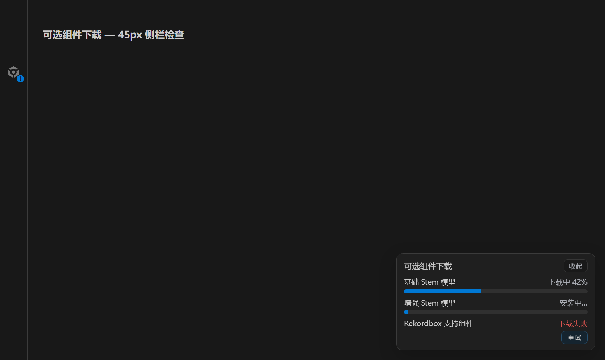
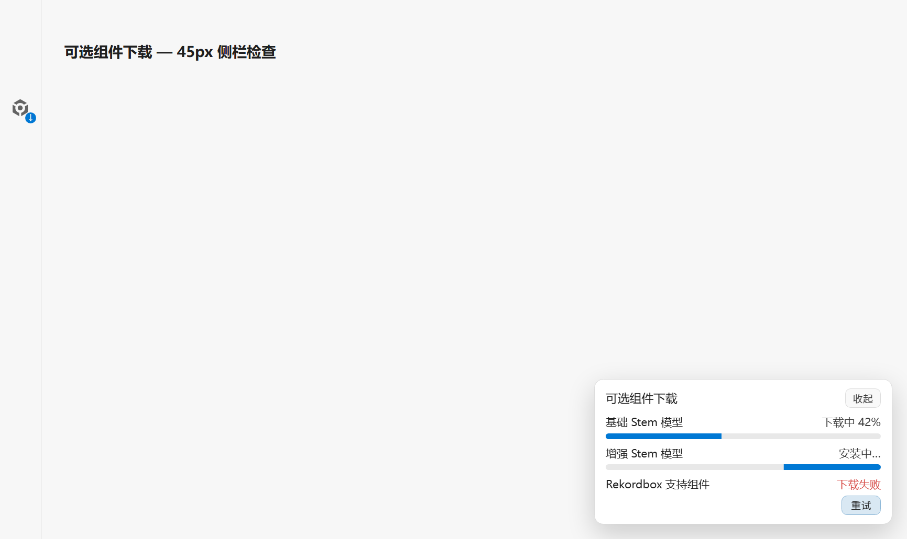

# 基础 Stem 与 rekordbox 组件按需下载

本轮范围仅包含基础 Stem 模型、rekordbox Python 环境。演示音乐、FFmpeg、原生解码依赖、ONNX 能量分析资源保持现有分发方式；段落分析不在本轮范围。

## 使用流程

- 基础 Stem：用户实际提交分离任务时，先校验所选模型；缺失时只下载该模型。`htdemucs` 约 84 MB，`mdx_extra_q` 四份权重合计约 168 MB。两种模型独立保存，同类并发请求合并。
- rekordbox：启动及定时探测只读取本机状态。缺组件时资料库区域保留下载入口；用户点击并确认后下载当前平台对应环境。下载失败保留入口，支持重试。
- 下载状态显示在可收起的组件面板中，不复用 AI 运行时或 Ultra 模型的状态。错误提示脱敏，下载失败不改变现有歌单和选中状态。
- 已安装组件支持离线复用。原有 CPU/GPU AI 运行时和 Ultra 模型继续使用各自下载链路。

## 存储与校验

- 基础模型：`userData/demucs-models/<模型名>`；权重 URL、SHA-256、模型 YAML 随应用代码固定，下载源为项目 `demucs-base-model-assets` 资源 Release，保留上游原文件及许可证。
- rekordbox：`userData/rekordbox-desktop-runtime/<平台>/python`；独立资源 Release 为 `rekordbox-runtime-assets`，平台仅 `win32-x64`、`darwin-arm64`、`darwin-x64`。
- rekordbox 归档名包含资源版本；所有平台归档上传成功后才更新完整清单，旧归档保留。该资源 Release 不设为应用最新版。
- 下载复用主进程代理链路，校验归档/权重 SHA-256 后暂存安装。验证通过后才启用，失败保留旧组件；不以系统 Python 替代缺失的打包组件。
- 小型 Python 桥脚本仍跟应用发布，不属于可下载环境。

## 打包与发布

Windows/macOS 的模型和 Python 环境从 `extraResources` 移除；应用构建不再执行这些资源的下载或环境制作。

`Rekordbox Runtime Assets` 工作流独立制作并验证三个平台的环境。`verify-optional-component-packaging.mjs` 检查实际 resources 和 ASAR，阻止模型或 Python 环境意外进入安装包。Linux 不作为构建或验收目标。

本地原始资源约减少 410 MiB（基础模型约 240 MiB，Windows rekordbox 环境约 170 MiB）；这是未压缩体积，不能直接等同于安装程序缩小量。

## 验收记录

施工由原 CodeBuddy 会话并发完成，固定模型 `deepseek-v4.1-flash`；root 审核并运行检查。第一轮发现的归档根目录误拒绝、并发测试时序、UI fixture 和 USB 弹出回归均进入返工。

- `npx vue-tsc --noEmit` 与 `pnpm run build` 通过；新增 IPC 的主进程、preload 白名单和 renderer 调用名已对照。
- 18 个相关 Vitest 文件 / 111 项测试通过；Windows Python 启动路径测试另有 3 项通过、1 项非 Windows 分支跳过。Node 脚本 44 项测试通过。
- 两套真实基础权重经新安装核心完成 YAML / SHA 校验、按模型隔离安装、并发合并与零网络复用。默认 `htdemucs` 从新目录加载成功；旧 `mdx_extra_q` 的加载在本机 CPU 运行时缺少 DiffQ，此为既有运行时限制，本轮未修改该运行时或扩展模型选项。
- 公开 GitHub Windows 资源已走生产下载函数完成清单读取、归档下载和 SHA 校验；同一公开归档在深层临时 userData 下完成暂存验证、激活后验证和新实例离线复用。另以只导入依赖的测试桥验证真实持久 helper 启动，未访问或写入用户资料库。
- Windows 超过 MAX_PATH 的 Python 扩展库加载问题已修复：自有解释器入口与 Python home 统一使用扩展长度路径，保留用户显式解释器的环境语义。
- 实际 Windows 目录打包成功，resources / ASAR 排除检查通过。自定义输出目录时旧 `dist` 曾被嵌入 ASAR，已在打包文件规则中显式排除；构建和打包必须串行，避免重建替换打包正在读取的文件。
- Windows、Intel Mac、Apple Silicon 首批资源构建与独立资源 Release 发布成功。新增解包迁移检查发现 Mac `/var` 与 `/private/var` 路径别名误判，校验已改为比较真实路径；该检查的跨平台重跑结果待补记。
- 亮暗主题均已用实际 Vue 组件在隐藏 Electron 窗口截图检查：下载状态、重试按钮可见，36px 入口完整落在 45px 侧栏内。截图见下。

## 相关代码行数

| 文件 | 实际行数 |
|---|---:|
| `scripts/demucs-model-ensure.spec.mjs` | 96 |
| `scripts/lib/demucs-model-ensure.mjs` | 309 |
| `scripts/lib/demucs-runtime-support.mjs` | 709 |
| `scripts/merge-rekordbox-runtime-assets.mjs` | 70 |
| `scripts/merge-rekordbox-runtime-assets.spec.mjs` | 63 |
| `scripts/package-rekordbox-runtime-assets.mjs` | 354 |
| `scripts/package-rekordbox-runtime-assets.spec.mjs` | 118 |
| `scripts/validate-rekordbox-desktop-runtime.mjs` | 165 |
| `scripts/validate-rekordbox-runtime-archive.mjs` | 64 |
| `scripts/verify-optional-component-packaging.mjs` | 52 |
| `scripts/verify-optional-component-packaging.spec.mjs` | 45 |
| `src/main/demucs.ts` | 218 |
| `src/main/index.ts` | 901 |
| `src/main/ipc/optionalComponentHandlers.spec.ts` | 91 |
| `src/main/ipc/optionalComponentHandlers.ts` | 44 |
| `src/main/services/demucsBaseModelDownload.spec.ts` | 183 |
| `src/main/services/demucsBaseModelDownload.ts` | 195 |
| `src/main/services/demucsBaseModelDownloadCore.spec.ts` | 362 |
| `src/main/services/demucsBaseModelDownloadCore.ts` | 323 |
| `src/main/services/mixtapeStemSeparationRun.ts` | 944 |
| `src/main/services/optionalComponentEvents.ts` | 24 |
| `src/main/services/rekordboxDesktopLibrary/detect.ts` | 233 |
| `src/main/services/rekordboxDesktopLibrary/helper.ts` | 619 |
| `src/main/services/rekordboxRuntimeArchive.spec.ts` | 185 |
| `src/main/services/rekordboxRuntimeArchive.ts` | 155 |
| `src/main/services/rekordboxRuntimeDownload.spec.ts` | 517 |
| `src/main/services/rekordboxRuntimeDownload.ts` | 684 |
| `src/main/services/rekordboxRuntimePythonLaunch.spec.ts` | 39 |
| `src/main/services/rekordboxRuntimePythonLaunch.ts` | 28 |
| `src/preload/index.ts` | 406 |
| `src/renderer/src/App.vue` | 1095 |
| `src/renderer/src/components/OptionalComponentDownloadsOverlay.vue` | 270 |
| `src/renderer/src/composables/useOptionalComponentDownloads.spec.ts` | 132 |
| `src/renderer/src/composables/useOptionalComponentDownloads.ts` | 228 |
| `src/renderer/src/pages/modules/librarySelectArea.vue` | 1096 |
| `src/renderer/src/pages/modules/librarySelectArea/RekordboxRuntimeMissingEntry.vue` | 127 |
| `src/renderer/src/pages/modules/librarySelectArea/pioneerDriveEjectError.ts` | 22 |
| `src/renderer/src/pages/modules/librarySelectArea/rekordboxRuntimeDownload.ts` | 87 |
| `src/renderer/src/pages/modules/librarySelectArea/useRekordboxSourceIcons.spec.ts` | 401 |
| `src/renderer/src/pages/modules/librarySelectArea/useRekordboxSourceIcons.ts` | 1097 |
| `src/shared/optionalComponentDownloads.ts` | 29 |
| `src/shared/rekordboxRuntimeDownload.ts` | 227 |
