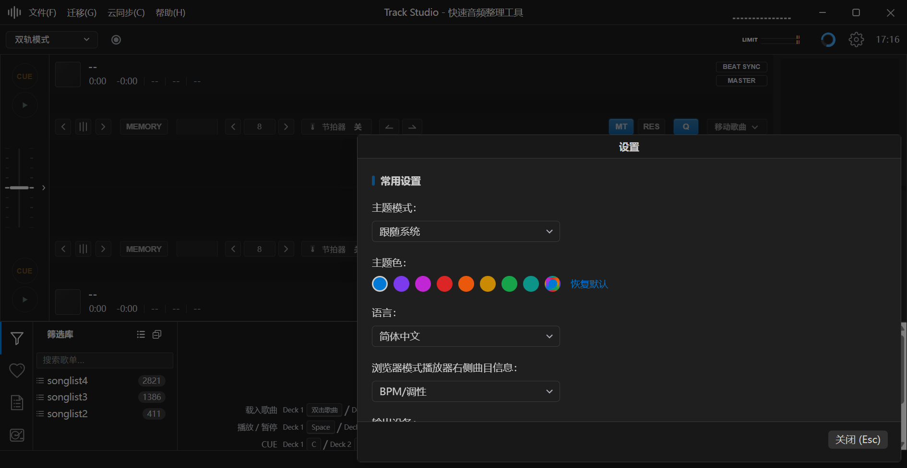
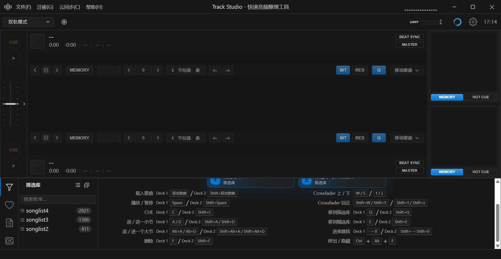
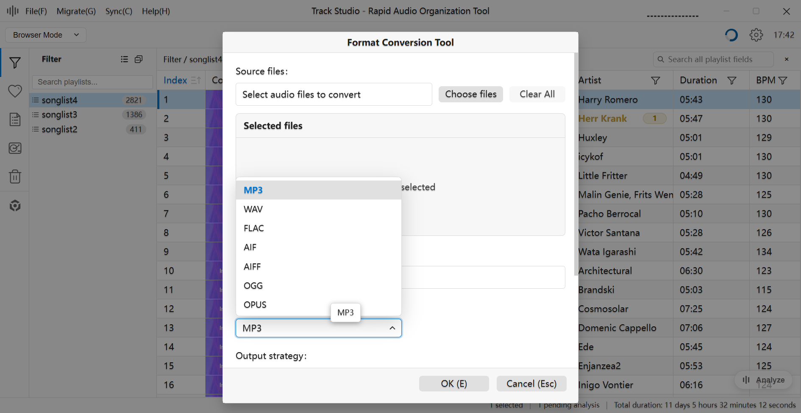
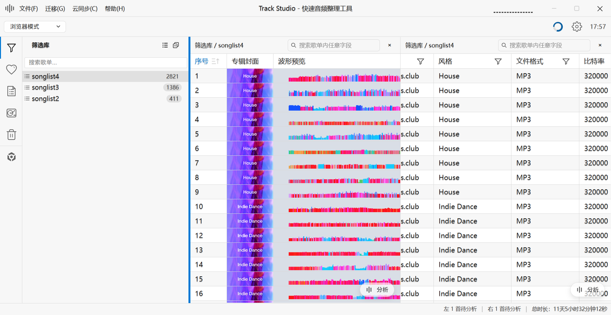
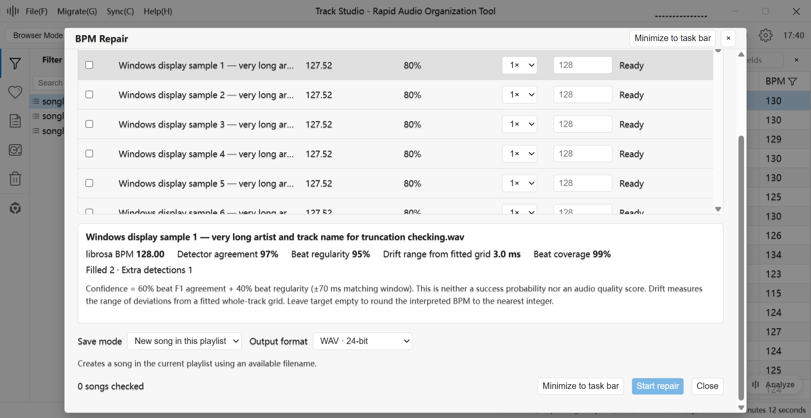
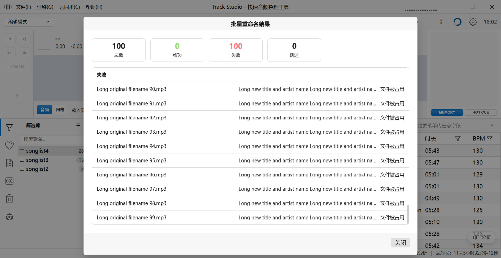
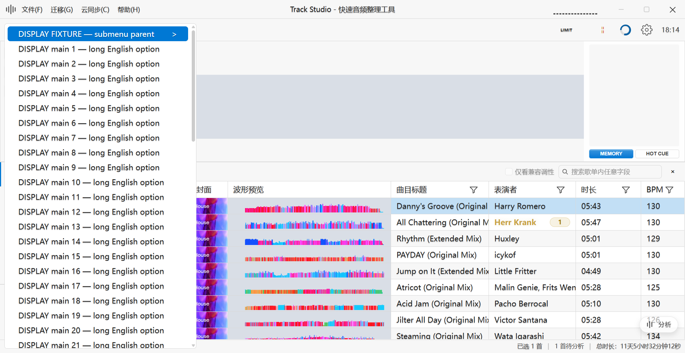
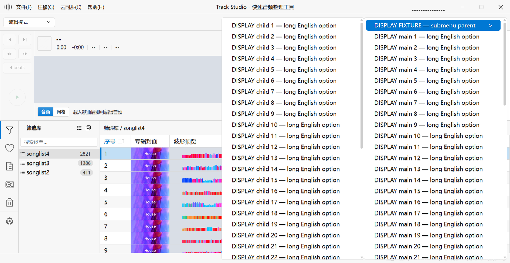
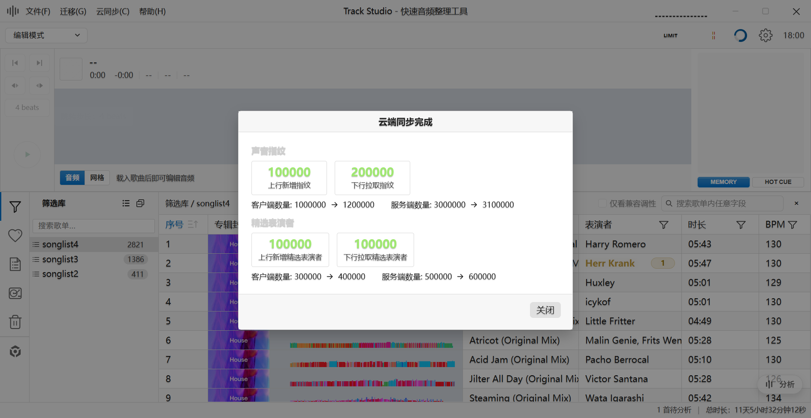

# Track Studio 小窗口适配 Windows 回归报告

后续状态：用户已授权修复F01/F02，两项已修改并完成独立组件验证，见[修复验证记录](fix-verification/修复验证记录.md)。下文保留修复前回归事实与覆盖边界。

日期：2026-10-26（Asia/Shanghai）。真实界面截图时间约 16:50–18:39。仓库根目录：`C:/playground/Track-Studio`。本目录为本机新增记录；未使用上一台 Mac 的路径或会话。

## 1. 总体结论与验收边界

**本轮不能签署“1260×650 下全部功能完整可用”。** 在当前显示器、100%页面缩放下，最接近最小值的实测 renderer 为 **1260×651 CSS px**；已检查真实配置入口的标题、正文滚动和取消/关闭按钮均可访问，未复现拖至边缘后缩窗导致弹窗丢失。欢迎页末尾能够通过滚动完整到达；不能把其首屏未显示末尾误报为不可访问。

本轮发现 **1 项普通数组菜单的夹具复现功能问题（P2）**、**1 项亮色结果页文字过浅的夹具复现可读性问题（P3）**。它们不是本轮真实业务结果状态的复现，也没有证据证明仅 Windows 存在。未发现已测真实入口的 P0/P1 布局阻断；这不覆盖未测场景。

以下限制直接影响结论：

- 实际屏幕是 Electron 单显示器 2560×1440 DIP、工作区 2560×1392 DIP、scaleFactor 1.5。实际执行最大化且确认 isMaximized=true；**不是此前参考的 1280×752 笔记本工作区**。本轮不能替代该笔记本、225%缩放验收。
- 系统最小尺寸 API 是1260×650，但 setBounds、setContentSize及手动拖到下限实得651高。没有提高最小高度，也没有改页面缩放。精确650的真实窗口结果尚未取得，不能用截图高度代替。
- 设置完成明/暗×中/英×最小/真最大化矩阵；其他业务入口主要抽测亮英或亮中。**没有把每个弹窗的所有主题、语言、尺寸和动态状态都判定通过**。
- [覆盖清单](覆盖清单.md)逐一列出 82 个源码界面/浮层/宿主：30项含真实入口部分验证、3项真实加夹具部分验证、19项仅夹具部分验证、30项未覆盖。这些是组件/宿主计数，不是互不重复的业务用例数或通过率。
- 运行中、真实结果、特殊数据、引导及独立窗口仍有缺口，详第7节。历史 Mac 报告、代码推断和本轮单元测试均未计为本轮 Windows GUI 通过证据。

### 启动产生了自动后台行为，不能称为完全只读运行

人工操作未点击删除、移动、写标签、重命名执行、转换执行、正式导出、分析执行、BPM校正执行、录音、同步执行，也未重置资料库。实际导入/导出/标签/重命名/转换/Stem/同步窗口均只查看配置或只读预览后取消。

**但停止进程时检查完整日志，发现应用启动后已经自动处理分析队列，并按既有设置尝试定时同步。** [key-analysis]诊断含34个不同jobId（范围1–45，含waveform-start→waveform-done）；这不是全部任务数，也不是成功/写入数量。同步请求连接 localhost:3001 失败（ECONNREFUSED），未观察到成功同步。没有通过人工按钮启动这些任务，但它们确实发生，不能写成“没有运行分析/同步”。

代码中闲时扫描与分析落盘链路客观存在：`src/main/services/keyAnalysis/background.ts:107`默认启用，`src/main/services/keyAnalysisQueue.ts:378`启动后台扫描，`src/main/services/keyAnalysis/persistence.ts`包含分析缓存/网格持久化；`src/main/cloudSyncScheduler.ts:123`默认立即调度。日志证明任务阶段执行，**没有运行前资料库快照，无法确认具体缓存、数据库变化数量，也不能保证资料库完全未变**。没有尝试回滚资料库。发现后已停止本次开发进程，最终系统进程查询无Electron实例。证据：[自动行为摘要](automatic-work-evidence.json)、[完整开发日志](dev-ui-ready.log)。后续补测应先准备隔离资料库并明确阻断自动后台任务，再启动，避免再次影响既有资料库。

## 2. 仓库、版本和本地改动

|项目|本机核对结果|
|---|---|
|工作区/根目录|当前会话 C:/playground/Track-Studio，git rev-parse确认|
|origin|https://github.com/coderDJing/Track-Studio.git|
|项目文件|package.json name=frkb、description=Track Studio；Electron main/preload/Vue renderer结构匹配|
|初始状态|main，2944d25d2caa2d885291b837ad82375d94b16218，初始工作树干净|
|规则|确认身份后阅读根目录AGENTS.md；拉取后复核新增文档规则|
|拉取|git pull --ff-only origin main，快进成功，无冲突；没有reset、clean、覆盖或丢弃本地改动|
|实际测试提交|14aefd5aba408af9eae3076125dd3942c1aecb1a|
|适配提交|2944d25d2caa2d885291b837ad82375d94b16218为测试提交祖先|
|RC标签|1.2.6-rc.202610261612指向2944d25d；运行app.getVersion同值|
|后续差异|仅14aefd5a：AGENTS.md与drafts/small-window-audit-20261026/Windows接手提示词.md文档变化，无运行时代码差异|
|本轮改动|只新增本Windows回归目录；没有修改已跟踪业务源码；无提交、推送、发版|

[版本记录](git-baseline.txt)。历史“小窗口适配检查报告”“适配交付与Mac回归”只用于梳理入口和背景。

## 3. 开发环境与启动核验

Windows 11 专业版10.0.26300 x64；Node v24.14.0、pnpm9.15.9、Electron43.7.11。按锁文件执行 `pnpm install --frozen-lockfile`成功；未改锁文件。日志：[dependencies.log](dependencies.log)。

首次 `pnpm run dev`完成Rust debug构建、媒体工具检查和Rekordbox运行时准备，但Demucs自动运行时准备出现无效URL，随后尝试重建本地Python运行时并安装较大依赖，手动停止。相关vendor运行时目录是被忽略的开发环境产物，存在CPU运行时被重建/安装未完成的可能；不能声称Demucs真实运行环境验证成功。另有Electron path.txt缺失，显式沿用本机系统代理安装Electron后恢复，未更改系统代理配置。

为继续布局检查，最终仅在启动进程环境设置 `FRKB_SKIP_DEMUCS_RUNTIME_ENSURE=1`，运行 `pnpm run dev --inspect 9229`，并启用本地CDP端口9222测量。**这是绕开当前环境准备阻塞的临时测试条件，不是根因修复，也不代表普通无跳过启动通过。** 开发版可用日志：[dev-ui-ready.log](dev-ui-ready.log)；初次失败/准备过程：[dev.log](dev.log)、[dev-ui.log](dev-ui.log)、[electron-install.log](electron-install.log)。

核验实际主进程PID38184，进程可执行文件位于本根目录node_modules/electron/dist/electron.exe，process.cwd及app.getAppPath均为本根目录；webContents与renderer均加载 **http://localhost:5173/**。PID、命令行见[processes.json](processes.json)，每次截图均重新保存来源和API测量；不是已安装版本或旧进程。本轮完成后停止dev，环境终态见[environment-final.json](environment-final.json)。

### 屏幕与尺寸单位

Electron screen.getAllDisplays只返回一个显示器：id1288209420；bounds=(0,0,2560,1440) DIP、workArea=(0,0,2560,1392) DIP、scaleFactor=1.5。WMI另报告GameViewer虚拟显示适配器3840×2160@144和NVIDIA适配器1024×768@60；不能把第二个适配器记录当作应用所在第二屏，应用可见显示器以Electron API为准。实测数据与此前2880×1800/225%参考不同，未伪造笔记本最大化。

- BrowserWindow bounds/contentBounds：Electron屏幕DIP；下表记录位置与尺寸。
- renderer inner/client/outer：DOM CSS px；getZoomFactor始终1，devicePixelRatio始终1.5。DOM outer与Electron外框数值不同，分别保留，未强行等同。
- 原始截图：renderer客户端捕获的PNG像素，通常1890×977（651×1.5取整），最大3840×2088；**不是窗口外框截图**。逐张实际PNG头尺寸见[截图索引](截图索引.md)，不能用它反推缺失API。
- 自定义标题栏35 CSS px在renderer中，未再次从innerHeight扣除。documentElement.lang为空，语言取自现场UI选择和记录，不把空lang当中英文状态来源。

|场景|外框 x,y;宽×高 DIP|客户端 x,y;宽×高 DIP|inner / client CSS px|DOM outer CSS px|zoom / DPR|真最大化|
|---|---|---|---|---|---|---|
|默认启动，未假定650|650,305; 1261×782|651,305; 1260×782|1260×782 / 1260×782|1275×789|1 / 1.5|否|
|请求外框1260×650|0,0; 1262×651|0,0; 1260×651|1260×651 / 1260×651|1276×658|1 / 1.5|否|
|请求客户端1260×650|0,0; 1264×651|0,0; 1262×651|1262×651 / 1262×651|1278×658|1 / 1.5|否|
|鼠标拖到最小下限|0,0; 1261×651|0,0; 1260×651|1260×651 / 1260×651|1275×658|1 / 1.5|否|
|调用真实maximize并读取状态|-7,-7; 2576×1408|0,0; 2560×1392|2560×1392 / 2560×1392|2560×1392|1 / 1.5|是|
|大窗口1500×950请求|0,0; 1502×951|0,0; 1500×950|1500×950 / 1500×950|1516×958|1 / 1.5|否|
|恢复默认780高度请求|0,0; 1262×781|0,0; 1260×780|1260×780 / 1260×780|1276×788|1 / 1.5|否|

所有逐帧完整测量：[measurements.jsonl](measurements.jsonl)。API已读取的项目没有用截图尺寸替代；精确650高与参考笔记本工作区无法取得，明确未覆盖。

## 4. 真实入口检查结果

状态V/P表示“本行列明范围已实际验证”，不是整个组件全部状态通过。长内容初屏看不到、但滚动到底可到达，记为正常可滚动。

|范围/入口|真实操作与结果|证据|限制|
|---|---|---|---|
|设置正文与关闭|滚到最后的危险区域，底部关闭始终可见；没点击危险操作|08、34|每个设置组合未逐条改值|
|拖动与动态缩窗|拖向右/下及左/上边缘；大窗拖动后缩回最小；反复最大化/还原后标题和关闭可访问，未见累计偏移或无法找回|05–07、39–42|不是所有弹窗都逐一重复四边循环|
|颜色面板|暗中、亮中初次展开色条/HEX可见；父窗拖动时跟随；锚点滚出可视区后面板收起；缩窗时收起|04、05、09、10|未输入/修改颜色；四边独立展开矩阵及显式关闭父窗时仍开面板未全部覆盖|
|通用下拉|短主题/语言，分析范围9项；Down高亮、Enter实际选择主题/语言；Tab关闭；转换格式7项靠底部向上展开，Esc只收下拉|09–13、32|长英文嵌套选项未全覆盖；内部点击不误关只做有限观察|
|欢迎页|双轨顶部与末尾、浏览器顶部与末尾均能通过滚动到达|02、03b、58、59|没点击新建/导入|
|浏览器列表|真实2821首歌单，长曲名、封面、预览波形、工具/底栏可见；亮色波形区域灰底|22|只验证已有列表展示，不等同已载入播放器波形|
|双轨/编辑|空载播放器布局、工具栏、Memory/HotCue区域；编辑模式真最大化再缩回可用|02、50–52|未载入/播放歌曲，真实长波形、编辑选区、录音未覆盖|
|双栏与侧栏|真实右侧显示双栏、横向滚动到后续列；侧栏加宽后两栏及底栏仍可见，再恢复宽度|48、49|35/47是切换前瞬态，不能作为双栏通过证据|
|导入/导出|打开真实配置；导入内文件选择与歌单选择嵌套，标题/按钮可见，全部取消|25–28|未执行；默认删除源选项未修改；深层目录/长树未覆盖|
|标签与MusicBrainz|标签正文滚到底到封面，底部Save/Cancel可见；嵌套MusicBrainz打开并显示无匹配，取消|20、21|不写标签，不覆盖候选长列表|
|筛选/搜索|真实BPM数值筛选，底部按钮换行仍可见；全局House搜索，多条长路径，取消|24、53|其他筛选类型未逐一；日期是夹具|
|批量重命名|真实配置、嵌套预设、只读预览2821条（44问题、2777勾选），正文/底部可见，取消|16–18|无重命名执行；真实结果未覆盖|
|格式转换|配置滚到最后，格式下拉向上打开且可Esc收起，底部可访问|32、33|无转换/真实进度与结果|
|重新分析配置|打开歌单触发缺失分析配置，查看范围，Tab收起后取消|13|不是执行分析；范围独立弹窗用夹具|
|Stem/模型提示|真实工作台配置，打开超高质量页签出现约297MB模型提示，按钮完整；取消|56、57|不分离、不下载；环境准备有额外限制|
|同步设置|真实设置正文到底，Test/Save/Cancel完整，仅取消|34|没有人工同步；自动后台尝试单列说明，不计进度验收|
|快捷键、SET|真实设置嵌套全局呼出快捷键；2821首SET时长统计和两个cue选择区域可见，只取消/关闭|36、46|没改快捷键/曲目；播放器快捷键为夹具|
|资料库合并/迁移|真实介绍与“开始设置”配置，源未选，底部可见后取消|54、55|未执行迁移/合并；独立迁移窗口不是同一覆盖项|
|真实右键菜单|底部歌单菜单滚到最后；曲目子菜单向左翻转；父菜单滚动后子菜单收起|14、15、19|四角/超长子菜单/键盘主要用夹具补充|

### 设置主题/语言/尺寸矩阵

|主题/语言|最小附近实测|真最大化|动态变化|
|---|---|---|---|
|暗/中文|04、07、08、40、42|39、41|大窗拖边缩回；多次循环|
|亮/中文|09、43、45|44|缩回后复查|
|亮/英文|12（客户端1262×651）、23（1260×651）|11|手动最小拖动；颜色/格式下拉|
|暗/英文|37|38|最大化后缩回|

该矩阵属于设置代表入口；不能据此把所有业务弹窗的四组合都填成通过。

**大窗口拖到右下后缩回最小，标题与底部仍可访问**（真实入口；暗色/简体中文）。外框 1262×651 DIP；客户端 1260×651 DIP；renderer inner/client 1260×651/1260×651 CSS px；zoom 1、DPR 1.5；PNG 1890×977 px。

**双轨欢迎页滚到末尾，呼出/隐藏说明可见**（真实入口；暗色/简体中文）。外框 1262×651 DIP；客户端 1260×651 DIP；renderer inner/client 1260×651/1260×651 CSS px；zoom 1、DPR 1.5；PNG 1890×977 px。

**实际转换配置的格式下拉向上展开**（真实入口；亮色/English）。外框 1261×651 DIP；客户端 1260×651 DIP；renderer inner/client 1260×651/1260×651 CSS px；zoom 1、DPR 1.5；PNG 1890×977 px。

**真实双栏列表与加宽侧栏**（真实入口；亮色/简体中文）。外框 1262×651 DIP；客户端 1260×651 DIP；renderer inner/client 1260×651/1260×651 CSS px；zoom 1、DPR 1.5；PNG 1890×977 px。

## 5. 隔离展示夹具验证（不是真实业务执行）

夹具直接在本工作区dev renderer挂载原有Vue组件，沿用应用主题/翻译上下文，使用FIXTURE前缀的假路径、固定计数与只读快照；确认、保存、执行回调被取消/拦截。挂载和清理代码均保存在本目录fixture-*.js，未改业务源码。测试结束卸载并清理临时BPM快照；真实任务已存在时BPM夹具会拒绝运行。**它们验证组件显示和滚动，不证明真实业务控制器、IPC、权限、异步状态切换正常。** 部分组件挂载仍会读取本地配置；本节“展示”不等于整个运行进程无后台行为，后者已单列。

|夹具|内容/结果|证据|未验证|
|---|---|---|---|
|日期浮层|between第二日期向上定位，日历/时间列和底部可见|29-fixture-date-up-light-en|真实日期字段入口、父窗拖动跟随|
|BPM校正|80条长假文件名ready状态，内列表与外正文双滚动；滚到底见保存配置及关闭；亮英、暗中最小/真最大化/缩回无丢失|30、31、fixture-bpm-*|真实分析、校正、busy/error/completed、恢复任务按钮|
|导入/指纹结果|100000量级计数，底部完整|fixture-result-1/2|真实导入/处理执行；亮色文字问题见F02|
|转换结果|80条极长错误，嵌套/外部滚动区域与底部存在|fixture-result-3|真实转换；未把每个嵌套滚动都滚到最后|
|同步总结|大计数，几何完整|fixture-result-4|真实同步/真实结果；亮色文字F02|
|重命名结果|100条长失败项，实际拖滚动条到第100条，底部关闭可见|fixture-result-5、fixture-rename-result-end|真实重命名结果|
|指纹导入/导出/手动|空输入配置展示，标题/按钮完整|fixture-config-1/2/3|文件选择、提交及真实异常|
|XML/混音输出|长歌单/输出名配置展示|fixture-config-4/5|正式导出/实际输出|
|编辑保存/离开|长文件名、长版本名、MP3非无损说明及按钮完整|fixture-config-6/7|真实音频编辑与保存|
|播放器快捷键|togglePlayPause展示|fixture-config-8-corrected|真实修改；旧8使用错误key已废弃，不算产品问题|
|分析范围/重分析|100000首计数配置，标题/底部可见|fixture-config-9/10|真实执行，所有选项组合|
|相似曲目|空种子、超长错误文本，正文/底部可访问|fixture-config-11|真实结果列表/网络推荐/播放|
|运行时准备|75%加长提示，可见完整卡片|fixture-config-12|真实下载、断网/错误/结束|
|首次对齐|大计数与长英文提示，有正文滚动，初始标题/底部可见|fixture-config-13|最后选项未滚到底；首次真实决策未覆盖|
|长右键菜单|61项主菜单、40项子菜单；四角、向左/右、跨层移动、主/子列表末项、W/S键高亮、主菜单缩窗|fixture-menu-*、fixture-submenu-*|普通数组有F01；子菜单开着缩窗未单独实测|

BPM真实入口`src/renderer/src/utils/bpmFixActions.ts:149–164`会先准备运行时并调用`audio:bpm-fix:analyze`，因此按用户边界没有点击此入口，不能把夹具写成真实BPM校正验收。右键菜单的现有键盘导航是W/S；右方向键不进入不是本轮确认的缺陷。通用BaseSelect的方向键验证与该菜单机制分开记录。

**BPM校正80条展示夹具，正文滚到底与底部配置**（隔离展示夹具；亮色/English）。外框 1261×651 DIP；客户端 1260×651 DIP；renderer inner/client 1260×651/1260×651 CSS px；zoom 1、DPR 1.5；PNG 1890×977 px。

**重命名结果展示夹具滚到最后一条**（隔离展示夹具；亮色/简体中文）。外框 1262×651 DIP；客户端 1260×651 DIP；renderer inner/client 1260×651/1260×651 CSS px；zoom 1、DPR 1.5；PNG 1890×977 px。

## 6. 问题（按严重程度）与代码风险

### F01 · P2 · 普通数组菜单的子菜单无法展开【隔离夹具已复现】

**入口/条件**：通用rightClickMenu组件接收普通非reactive的IMenu[][]，其中一项有children。亮色中文、最小附近renderer1260×651；展示菜单使用英文长文本。没有确认某个真实业务调用点同样失败，真实曲目菜单向左子菜单在本轮正常。

**复现步骤**：

1. 在本工作区dev renderer以`fixture-menu.js`挂载普通数组：一个父项+40子项+60主项，全部回调只卸载。
2. 将鼠标移到/点击父项。父项变蓝且显示箭头，但独立子菜单未出现，40个子项不可通过该面板访问。
3. 用`fixture-menu-reactive.js`将同样的数据包为vue.reactive后，父项可打开独立子菜单；向左/右、子列表到底与键盘进入也可工作。对照截图位置/背景模式不同，不是同坐标像素差分，核心数据内容与reactivity差别保留在两个脚本中。

**代码位置与原因**：`src/renderer/src/components/rightClickMenu.vue:80–90`用深ref存hoverItem，computed再用`item === hovered`/`children.includes(hovered)`匹配。普通props数组中的原始对象与ref包装后的代理对象身份不同，导致找不到submenuParent。`rightClickMenu.ts:26–27`将menuArr直接传入，并未要求调用方必须reactive，因此普通数组符合当前包装器形状。键盘分支:215/:227也有同类indexOf身份风险，后者仅代码推断，未单独复现。

**修复建议**：统一菜单项身份语义，评估shallowRef、稳定ID或一致的原始/代理比较；不要只在一个调用点强制reactive掩盖公共组件契约。补普通数组和reactive两种实际组件交互验证，覆盖hover/键盘父子层级。属于共用菜单逻辑修复，不需要提高窗口最小高度。

**普通数组：父项已高亮，子菜单未出现**（隔离展示夹具；亮色/简体中文）。外框 1262×651 DIP；客户端 1260×651 DIP；renderer inner/client 1260×651/1260×651 CSS px；zoom 1、DPR 1.5；PNG 1890×977 px。

**reactive对照：独立子菜单正常向左展开**（隔离展示夹具；亮色/简体中文）。外框 1262×651 DIP；客户端 1260×651 DIP；renderer inner/client 1260×651/1260×651 CSS px；zoom 1、DPR 1.5；PNG 1890×977 px。

### F02 · P3 · 亮色结果页部分标题/计数对比度低【隔离夹具已复现】

**入口/条件**：展示cloudSyncSummary及多个完成结果，亮色中文、renderer1260×651。几何内容并非被裁切，而是浅灰标题/浅绿成功计数在白底难辨。没有真实同步/导入/转换/重命名结果执行。

**复现步骤**：切换亮色主题，`fixture-results.js`依次显示大量计数结果，第4项同步总结可见浅灰分区标题、浅绿数字；第5项重命名结果可见浅绿/浅红数字。用`inspect-layout.js`读取computed style，保留原截图与JSON。

**证据和代码原因**：`cloudSyncSummaryDialog.vue:207`固定#d0d0d0、:244固定#9fe870，前景对白底计算比值约1.54:1和1.47:1；`playlistBatchRename/ResultDialog.vue:208/212`固定#ff7d7d/#96df75，约2.48:1/1.60:1。继承的文字阴影存在，但没有改掉前景色。此处比值是本机颜色计算的可读性佐证，不宣称完成了整套无障碍认证。

**同类位置**：`importFinishedSummaryDialog.vue:202`、`addSongFingerprintFinishedDialog.vue:158`、`conversionFinishedSummaryDialog.vue:173/210`也使用固定浅色。JSON：[cloud-summary-contrast.json](cloud-summary-contrast.json)、[result-layout.json](result-layout.json)。

**修复建议**：将结果统计标题、success/error数字、错误文字改为随主题变化的语义文本色；共享变量统一，各组件替换并复核明暗。保留正文滚动结构。该问题与窗口高度无关，不能归因于“内容不可访问”。

**亮色同步总结展示夹具：浅灰标题与浅绿数字**（隔离展示夹具；亮色/简体中文）。外框 1262×651 DIP；客户端 1260×651 DIP；renderer inner/client 1260×651/1260×651 CSS px；zoom 1、DPR 1.5；PNG 1890×977 px。

### R01 / R02 · 仅代码推断，未判为已复现缺陷

- **R01**：`useAnchoredPopover.ts:30–31`仅识别最近的OverlayScrollbars viewport裁剪，其他原生overflow祖先的锚点可见性可能需要额外处理。本轮设置锚点滚出收起正常；不能将该风险泛化为所有颜色面板或下拉已失败。建议在原生滚动容器中用夹具补测。
- **R02**：`DateTimePicker.vue:434–441`采用独立8px边距定位，:537–538监听resize/scroll；未见与父弹窗拖动逐帧位置同步的同等链路。夹具上展开后完整可访问，虽可接近顶部，**没有据此认定裁切**。父窗拖动跟随、锚点滚出/关闭后的处理仍需实测，再决定是否复用通用锚定逻辑。

## 7. 明确未覆盖的场景

逐组件状态与静态调用点见[覆盖清单](覆盖清单.md)，包括文件名不含Dialog的Teleport/fixed浮层、宿主和独立窗口。以下缺口不能由本轮正常结果填充：

1. 精确650高、225%缩放的1280×752笔记本最大化、多显示器跨屏；每个业务弹窗的明暗/中英/最大化/动态变化全组合。
2. 真正已加载播放器/编辑波形、长歌曲/多个cue、播放/录音中布局。已有2821首列表预览波形不等于播放器波形验收。
3. 同步进度、长错误、取消和成功总结；首次真实对齐的整段滚动/选择；已存在的自动同步连接失败不计上述状态通过。
4. 导入/转换/重命名/分析/分离/BPM校正的真实运行中、成功/失败结果。夹具只补显示；未开始业务制造结果。自动闲时分析虽确实发生，也没作为这些界面状态的人工验收。
5. MusicBrainz有匹配候选长列表；相似曲目真实种子推荐结果；自动补标签总结；特殊字符/超长路径的真实文件操作异常。
6. 超长目录树/歌单树、文件权限错误、外部DJ资料库目标、Rekordbox存储/新建节点/写入遮罩；当前没有为验证写入而构造外部任务。
7. Mixtape时间线、自动增益、节拍对齐、片段循环及独立Mixtape窗口；只有输出配置展示夹具，不能代表整套Mixtape。
8. 首次资料库设置、身份引导/聚光卡片、独立资料库迁移与更新窗口；没有重置资料库制造首次状态。LibraryMerge真实配置不等于所有迁移界面通过。
9. 通用输入/选择/危险确认的全部调用分支，文件操作中断窗口；列头独立菜单、封面大图、MiniPlayer及其更多菜单。
10. 气泡四角、禁用锚点、多层嵌套层级、长气泡；颜色面板开着关闭父窗、所有边缘独立展开；子菜单已展开时缩窗。已做普通气泡观察、主菜单缩窗和跨子菜单移动，未把它们扩成全面通过。

这些项在组件清单中标U或部分覆盖P；没有隐去，也没有用单元测试或Mac历史替代。安全可做但本轮尚未逐项完成的通用提示/列头菜单等同样标未覆盖，没有统一包装为“无法安全触发”。

## 8. 本机最终检查

开发进程先停止，再对测试提交执行以下命令。原始日志保留，都是本机实际执行，不是Mac记录：

|命令|退出码|开始/结束（本机时间）|实际结果|
|---|---|---|---|
|npx vue-tsc --noEmit|0|2026-10-26T18:39:39.2083763+08:00 / 2026-10-26T18:40:00.3925931+08:00|通过，无诊断输出|
|pnpm exec vitest run src/renderer/src/utils/overlayLayout.spec.ts src/renderer/src/utils/contextMenuPosition.spec.ts|0|2026-10-26T18:39:39.2127315+08:00 / 2026-10-26T18:39:41.7191368+08:00|2文件、9测试通过|
|pnpm run build|0|2026-10-26T18:40:19.5699494+08:00 / 2026-10-26T18:40:23.0917110+08:00|通过；main/preload/renderer产物生成、worker依赖检查通过|

日志：[vue-tsc.log](vue-tsc.log)、[vitest.log](vitest.log)、[build.log](build.log)。构建有一条INEFFECTIVE_DYNAMIC_IMPORT警告：bpmFixActions被动态及静态同时引入，不会拆成独立chunk；退出码0。未在本轮修改它。检查只能证明类型/既有布局算法用例/构建通过，不能证明全部GUI完整可用，不能消除环境/自动后台行为边界。

## 9. 建议处理顺序

1. **先补齐验收条件**：隔离资料库、阻断自动闲时分析/定时同步；恢复验证普通dev环境的Demucs准备；在目标笔记本真实工作区补精确最小/最大化测量。自动行为和运行时问题是测试环境/流程边界，不能伪装成已修复的UI问题。
2. **共用菜单逻辑**：处理F01的对象身份契约，双数据形态及键盘交互验证；它影响子项可操作性，应先于外观调整。
3. **共用主题文本色**：定义结果语义文字token，分别替换F02列明结果组件的硬编码颜色，同时复核暗色。不重写已验证可滚动的结果布局。
4. **补高风险浮层组合**：R01/R02、禁用气泡、列头/封面菜单、子菜单开着缩窗；只有复现之后再决定公共锚定/弹窗基础布局是否要改。
5. **单独复杂组件/状态**：BPM真实ready→busy→result、Mixtape、外部DJ、首次引导、超长结果，优先使用隔离夹具补明暗中英矩阵；真实执行需要后续另行授权的业务任务。

目前没有已复现证据支持为所有弹窗重做基础高度/拖动限制，更不应把最小高度调大来遮住问题。通用菜单、共用主题token与个别组件长内容状态应分别处理。

## 10. 文件索引与原始证据使用说明

- [覆盖清单.md](覆盖清单.md)：82个源码界面/浮层/宿主及独立窗口索引、部分验证/未覆盖原因。
- [截图索引.md](截图索引.md)：97张原始PNG，每张的外框/客户端/renderer/DOM outer、主题/语言、zoom/DPR、原图像素及真最大化标记；[机器可读索引](screenshot-index.json)。
- [measurements.jsonl](measurements.jsonl)：逐帧原始API结果，含来源URL、进程、显示器及可见弹窗几何。
- [cdp-audit.mjs](cdp-audit.mjs)：本地测量/截图脚本；fixture-*.js为展示用输入与清理，不属于业务代码修改。
- 原始过渡/无效夹具图也保留：03以03b为准；35/47未稳定到双栏，以48/49为准；config8错误actionKey以8-corrected为准；fixture-submenu-right普通数组没有子菜单，正确右展开是right-reactive。索引中已标注，不能选错证据宣称通过/失败。
- 开发日志包含实际曲目路径和背景任务记录，仅保存到本地审计目录；没有提交、推送或发布。本轮最终恢复系统主题（实际暗色）、简体中文、双轨、侧栏原宽与欢迎页，再停止开发进程。
