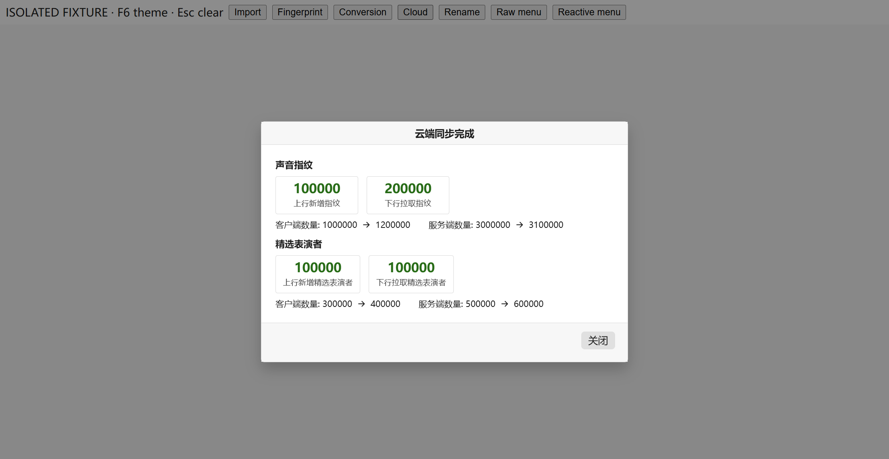
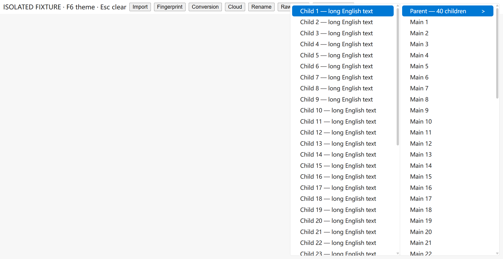
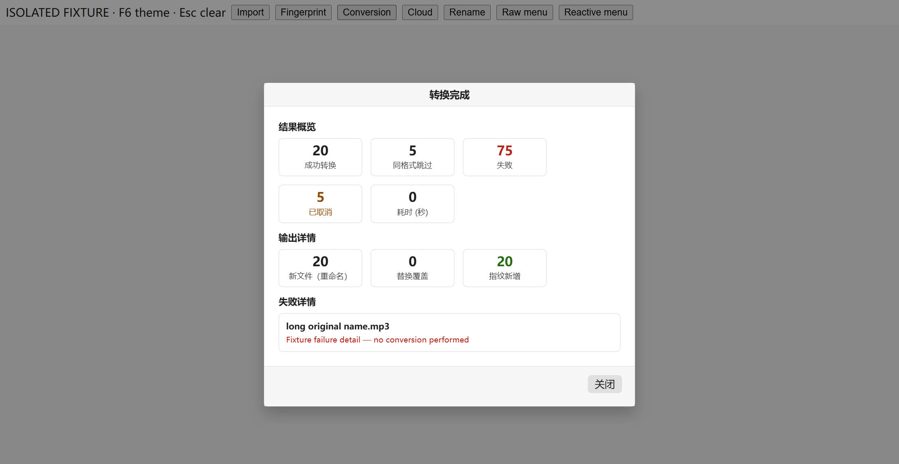

# 两项问题修复与独立展示验证

日期：2026-10-26。工作区：C:/playground/Track-Studio；基于14aefd5aba408af9eae3076125dd3942c1aecb1a的未提交修改。本记录对应原Windows报告F01/F02；原报告保留为修复前的发现记录。

## 修改

1. **F01：菜单对象身份**。rightClickMenu.vue把hoverItem改为shallowRef，保留从props取得的原始/响应式菜单项身份。父子菜单查找、includes/indexOf键盘遍历现在使用同一种对象；没有在调用点强行包装reactive，没有改变既有W/S导航规则。
2. **F02：结果文字**。main.scss新增明暗主题各自的success/danger/warning文字变量；五类结果组件替换固定浅色：导入结果、指纹结果、转换结果、同步总结、重命名结果；同步总结分区标题改用主题正文色。亮色使用深绿/深红/深棕，暗色保留明亮语义文字。

业务流程、IPC、最小窗口尺寸、版本号均未修改。没有提交、推送或发布。

## 自动回归

新增src/renderer/src/components/rightClickMenu.spec.ts，注册到现有vue-client测试项目，使用实际SFC与自定义Vue host renderer。覆盖普通数组和reactive数组的鼠标父/子项、W/S前进/后退、跳过disabled及Enter关闭。

修复前先运行：普通数组两项失败、reactive两项通过，失败分别是子面板不存在、键盘无法进入Child 1。改为shallowRef后四项通过，合并原布局测试共13项通过。测试替换动画/DOM宿主，不能替代浏览器几何检查；另有下述原组件窗口实测。

|命令|退出码|开始 / 结束（本机+08:00）|
|---|---|---|
|npx vue-tsc --noEmit|0|2026-10-26T20:37:38.2788417+08:00 / 2026-10-26T20:37:59.2047138+08:00|
|pnpm exec vitest run src/renderer/src/components/rightClickMenu.spec.ts src/renderer/src/utils/overlayLayout.spec.ts src/renderer/src/utils/contextMenuPosition.spec.ts|0|2026-10-26T21:06:03.3701658+08:00 / 2026-10-26T21:06:04.6807676+08:00|
|pnpm run build|0|2026-10-26T21:07:08.5266467+08:00 / 2026-10-26T21:07:12.0396506+08:00|

原始日志：[类型检查](vue-tsc.log)、[13项测试](vitest.log)、[构建](build.log)。类型检查无TS错误，npx输出了仓库npm配置识别警告；构建通过且保留原有bpmFixActions静态/动态重复导入警告。Prettier检查和git diff --check通过。

## 本机组件展示验证

为避免再次触发资料库后台任务，**本轮未启动生产App入口**。使用独立Electron BrowserWindow和独立userData目录，Vite加载当前工作区原有组件、main.scss、翻译、Pinia与拖动指令；没有生产main/preload、资料库/分析/同步处理器，外部请求在session层阻断。fixture.mjs只提供假数据和展示回调，不连接实际资料库。此处是Windows上的组件夹具验证，不能写成真实业务操作、真实结果生成或完整应用验收。

复验时renderer实测1259×650 CSS px、client同值、DOM outer1273×657 CSS px、DPR1.75；Electron启动日志记录外框1261×651 DIP、客户端1259×650 DIP、zoom1。当前缩放环境与前一轮DPR1.5不同；没有更改系统缩放/最小高度。截图原始2204×1138 px，不含窗口外框，未用图片像素推断API尺寸。本轮仅验证这两项修复，不据此撤销原报告对笔记本工作区和全部入口验收的限制。

- 普通数组：真实Sky点击父项后显示40项独立子菜单；S键进入Child 1，亮/暗均可见。对应raw-menu-light、raw-menu-keyboard-light、raw-menu-dark。
- 五类结果：导入、指纹、转换、同步、重命名均逐个打开并切换亮/暗；成功/错误文字清晰可见，标题和关闭可访问；转换另补已取消警告文字的两种主题。没有实际导入、转换、同步或重命名。
- 亮色成功数字对白底6.56:1，较修复前#9fe870的1.47:1提高；其余实际采集前景/背景和比值见color-summary.json。该测量是可读性佐证，不是整套无障碍认证。
- 验证完已关闭独立窗口，原资料库不会被这个展示主进程启动；上一轮自动后台行为历史仍保留在原报告。

## 原始截图索引

每次截图均保留renderer来源URL、主题、尺寸、选中菜单、子面板数、computed colors与弹窗几何于[measurements.jsonl](measurements.jsonl)。同标签重拍使用末次记录对应当前PNG，保留早期JSONL作过程记录。

|截图|主题|inner/client CSS px|DOM outer CSS px|DPR|PNG px|子菜单数|
|---|---|---|---|---|---|---|
|[baseline](screenshots/baseline.png)|theme-light|1259×650/1259×650|1273×657|1.75|2204×1138|0|
|[raw-menu-light](screenshots/raw-menu-light.png)|theme-light|1259×650/1259×650|1273×657|1.75|2204×1138|1|
|[raw-menu-keyboard-light](screenshots/raw-menu-keyboard-light.png)|theme-light|1259×650/1259×650|1273×657|1.75|2204×1138|1|
|[raw-menu-dark](screenshots/raw-menu-dark.png)|theme-dark|1259×650/1259×650|1273×657|1.75|2204×1138|1|
|[cloud-dark](screenshots/cloud-dark.png)|theme-dark|1259×650/1259×650|1273×657|1.75|2204×1138|0|
|[cloud-light](screenshots/cloud-light.png)|theme-light|1259×650/1259×650|1273×657|1.75|2204×1138|0|
|[import-light](screenshots/import-light.png)|theme-light|1259×650/1259×650|1273×657|1.75|2204×1138|0|
|[import-dark](screenshots/import-dark.png)|theme-dark|1259×650/1259×650|1273×657|1.75|2204×1138|0|
|[fingerprint-light](screenshots/fingerprint-light.png)|theme-light|1259×650/1259×650|1273×657|1.75|2204×1138|0|
|[fingerprint-dark](screenshots/fingerprint-dark.png)|theme-dark|1259×650/1259×650|1273×657|1.75|2204×1138|0|
|[conversion-dark](screenshots/conversion-dark.png)|theme-dark|1259×650/1259×650|1273×657|1.75|2204×1138|0|
|[conversion-light](screenshots/conversion-light.png)|theme-light|1259×650/1259×650|1273×657|1.75|2204×1138|0|
|[rename-light](screenshots/rename-light.png)|theme-light|1259×650/1259×650|1273×657|1.75|2204×1138|0|
|[rename-dark](screenshots/rename-dark.png)|theme-dark|1259×650/1259×650|1273×657|1.75|2204×1138|0|
|[conversion-warning-light](screenshots/conversion-warning-light.png)|theme-light|1259×650/1259×650|1273×657|1.75|2204×1138|0|
|[conversion-warning-dark](screenshots/conversion-warning-dark.png)|theme-dark|1259×650/1259×650|1273×657|1.75|2204×1138|0|

## 颜色测量摘要

|截图|实际读取的颜色与前景/背景对比度|
|---|---|
|cloud-dark|rgb(204, 204, 204): 10.26 rgb(159, 232, 112): 11.19|
|cloud-light|rgb(31, 31, 31): 16.48 rgb(39, 107, 22): 6.56|
|import-light|rgb(31, 31, 31): 16.48 rgb(180, 35, 24): 6.57 rgb(39, 107, 22): 6.56|
|import-dark|rgb(204, 204, 204): 10.26 rgb(255, 138, 138): 7.26 rgb(159, 232, 112): 11.19|
|fingerprint-light|rgb(31, 31, 31): 16.48 rgb(39, 107, 22): 6.56 rgb(180, 35, 24): 6.57|
|fingerprint-dark|rgb(204, 204, 204): 10.26 rgb(159, 232, 112): 11.19 rgb(255, 138, 138): 7.26|
|conversion-dark|rgb(204, 204, 204): 10.26 rgb(255, 138, 138): 7.26 rgb(159, 232, 112): 11.19|
|conversion-light|rgb(31, 31, 31): 16.48 rgb(180, 35, 24): 6.57 rgb(39, 107, 22): 6.56|
|rename-light|rgb(31, 31, 31): 16.48 rgb(39, 107, 22): 6.56 rgb(180, 35, 24): 6.57|
|rename-dark|rgb(204, 204, 204): 10.26 rgb(159, 232, 112): 11.19 rgb(255, 138, 138): 7.26|
|conversion-warning-light|rgb(31, 31, 31): 16.48 rgb(180, 35, 24): 6.57 rgb(138, 75, 0): 6.8 rgb(39, 107, 22): 6.56|
|conversion-warning-dark|rgb(204, 204, 204): 10.26 rgb(255, 138, 138): 7.26 rgb(255, 183, 77): 9.52 rgb(159, 232, 112): 11.19|

